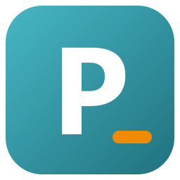
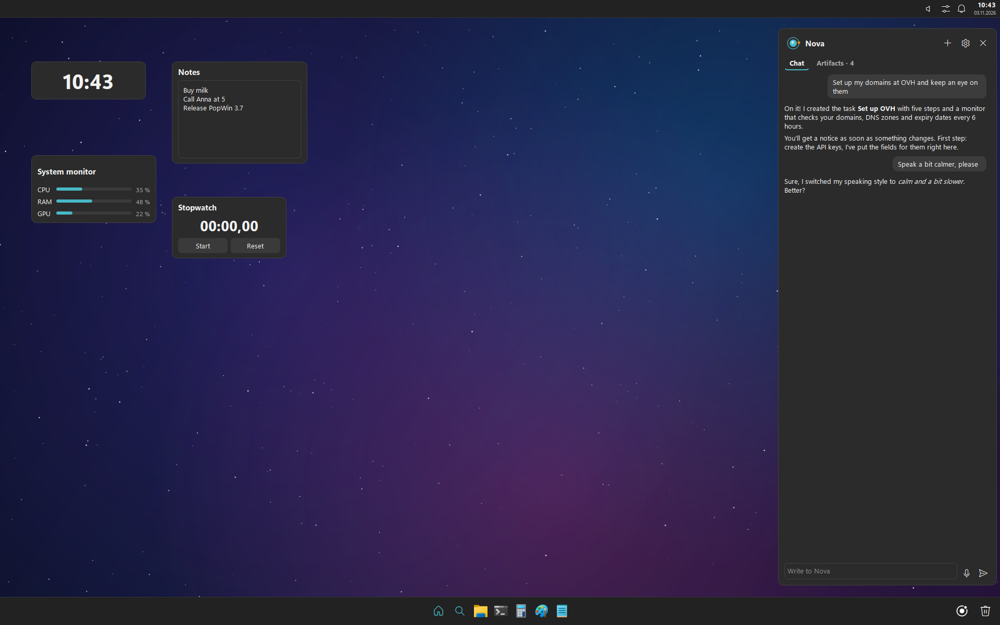
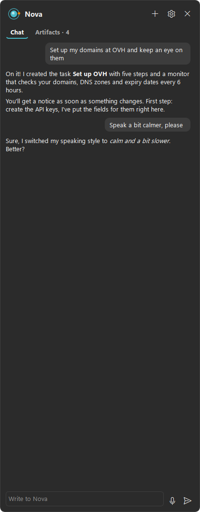
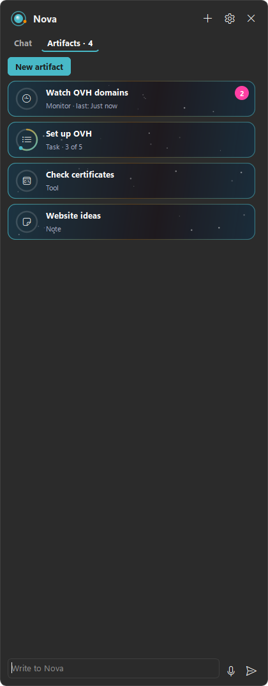
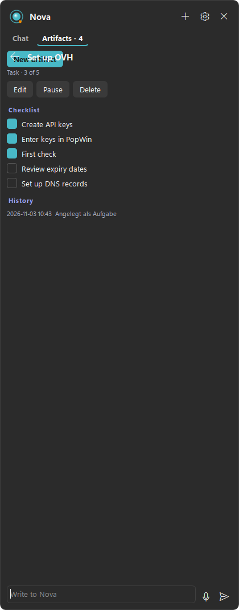
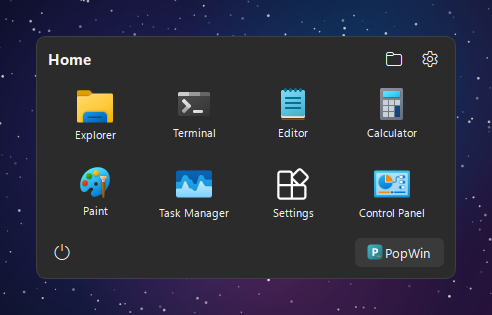
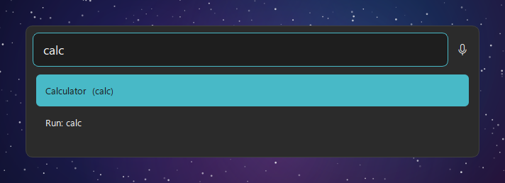
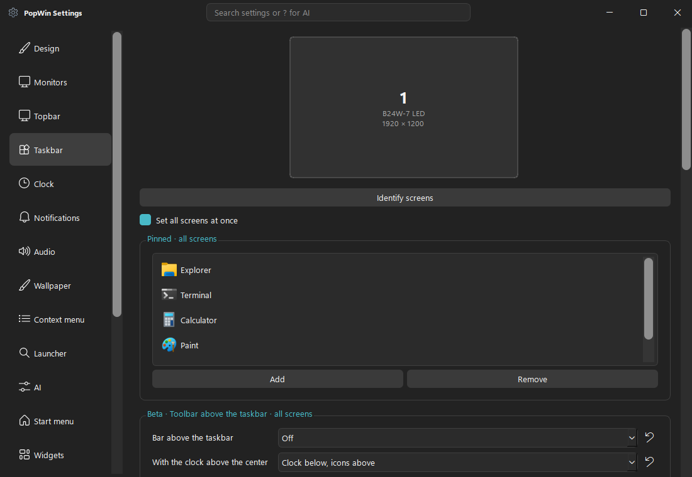
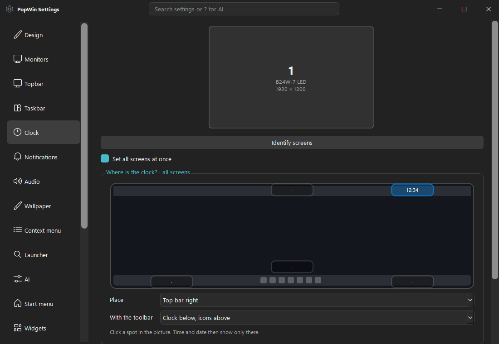

<p></p>

# PopWin

[](https://github.com/michig-code/PopWin/releases)


[](LICENSE)

Eine anpassbare Oberfläche für Windows 10 und 11: Topbar und Taskbar im Stil von Pop!_OS, eine schnelle Suche,
Desktop-Widgets und **Nova**, eine KI-Copilotin am Bildschirmrand, die live mit dir spricht und längere Aufgaben im
Blick behält.
**[English version](README.md)**

> 🤖 **PopWin ist mit Hilfe von KI entstanden.** Es wird zusammen mit **Claude** (Anthropic) entwickelt, das den
> Großteil von Code, Tests und Dokumentation geschrieben hat – siehe [Wie PopWin entsteht](#wie-popwin-entsteht).

<p></p>
<p>
  
  
  
</p>
<p>
  
  
</p>
<p>
  
  
</p>

*Die Screenshots zeigen Beispieldaten in der englischen Oberfläche.*

## Neu in 4.0
- **Einrichtung und „Was ist neu“** – ein animierter Willkommensbildschirm führt durch Theme, Taskbar-Form, Nova (Ja
  oder Nein), Leistung und Autostart. Nach jedem Update zeigt PopWin die Neuerungen einmal in kurzen Stichpunkten.
- **Themes** – eine Galerie mit Vorschaukarten und ein Editor für eigene Themes: Akzentfarben, Hintergrund, Deckkraft,
  Ecken und Leuchten mit Live-Vorschau. Teilen als `.popwin-theme`-Datei. Neu dabei: **Neon-Nacht**.
- **Topbar** – Symbole per Maus in jede Reihenfolge ziehen, Rechtsklick auf ein Symbol öffnet sein Menü, ein neues
  Mikrofon-Fenster (Pegel, stumm, Eingabegerät, welche App zuhört), ein Benutzer-Bereich mit Sperren, Benutzer wechseln
  und Abmelden, eine Anzeige der Tastatur-Sprache und Knöpfe für Bildschirm projizieren und das Ausschneide-Tool
- **Taskbar** – rote Zahlen für neue Mitteilungen, ein schwebendes Dock, neue Apps ploppen sanft herein, und Home,
  Suche, Player, Nova, Papierkorb und Desktop lassen sich an jeden Platz ziehen, auch auf die andere Seite der Apps
- **Startmenü** – fünf Varianten mit Vorschau: Raster, Liste, große Kacheln, schmale Leiste und Suche zuerst
- **Audio** – Schnelleinstellungen und Lautstärke-Fenster wechseln zwischen Ausgabe- und Eingabegeräten, so ist dein
  Standard-Mikrofon einen Klick entfernt
- **Benachrichtigungen** – ein Knopf für *Nicht stören* ganz unten im Benachrichtigungs-Fenster
- **Einstellungen** – nach Themen sortiert, mit einer Übersicht, die dein Theme zeigt und es per Dropdown wechselt,
  einem Leisten-Designer für Topbar und Taskbar und *Teilen & Presets* zum Speichern, Exportieren und Importieren
- **Leistung** – eine neue Seite mit den Stufen Sparsam, Ausgewogen und Schön, ein Spielmodus, der die Leisten hinter
  Vollbild-Spielen ruhen lässt, und auf Wunsch „Windows entlasten“ für Hintergrund-Apps wie Widgets oder Game Bar
- **Spiele** – die Leisten verkleinern kein Vollbild-Spiel mehr, die Maus ruckelt nicht mehr in Spielen wie Fortnite,
  und die Windows-Taste holt die Leisten schnell und weich herein

## Funktionen
- **Topbar und Taskbar** – auf allen Monitoren oder nur auf manchen, synchron oder pro Monitor eingestellt; volle
  Breite, nur so breit wie die Icons oder als schwebendes Dock, links, mittig oder rechts, Auto-Hide am Rand. Die Uhr
  steht genau dort, wo du in einem kleinen Bild deines Bildschirms hinklickst.
- **Taskbar wie bei Windows** – dieselben Symbole wie in der Windows-Taskleiste (Store-Apps, Java-Spiele, Web-Apps),
  feste Reihenfolge, verschieben per Maus, Live-Vorschau, rote Zahlen für Mitteilungen, Anheften durch Draufziehen
- **Topbar nach deinem Geschmack** – Symbole rechts auswählen und verschieben; Klick oder Rechtsklick öffnet
  Lautstärke, Mikrofon, Netzwerk, Schnelleinstellungen oder Benachrichtigungen
- **Symbolleiste über der Taskbar (Beta)** – Home, Suche, Nova und Papierkorb schweben in einer eigenen Leiste,
  immer oder nur beim Drüberfahren
- **Suche** – Apps, Systemaktionen und Win+R-Befehle schon beim Tippen, Spracheingabe und `?` für eine Frage an die KI.
  Passt nichts, schlägt die KI Aktionen vor, die erst nach deinem Ja laufen.
- **Home-Menü** – deine angehefteten Apps in einer von fünf Varianten, öffnet mit der Windows-Taste; einfach
  lostippen startet die Suche
- **Nova** – eine KI-Copilotin im Seitenpanel, siehe [unten](#nova)
- **Widgets** – 13 Desktop-Widgets (Uhr, Systemanzeige, Notizen, Stoppuhr, Netzwerk, Laufwerke, Player, …), jedes mit
  eigener Größe, Farbe, Ebene und Deckkraft. Sie bleiben bei Win+D stehen.
- **Schnelleinstellungen** – Dark Mode, Nicht stören, Bluetooth, Fokus-Timer, Audio-Ausgabe und -Eingabe, Lautstärke
  jeder App mit Live-Pegel
- **Hintergründe** – arbeitet mit Wallpaper Engine zusammen oder spielt eigene animierte Hintergründe hinter den Symbolen
- **PopWin-Apps** – ein Explorer mit Tabs und Vorschau, ein Editor, ein Terminal und PowerShell Studio mit Debugger;
  als Beta kann jede ihr Windows-Gegenstück ersetzen (ab Werk aus, Einstellungen → Beta)
- **Vollbild** – Spiele und Videos haben den Bildschirm für sich, danach kommen die Leisten zurück
- **Sicher** – die echte Windows-Taskleiste kommt zurück, wenn PopWin endet, auch nach einem Absturz
- **Feinschliff** – eingebaute und eigene Themes, hell und dunkel, weiche Animationen, drei Leistungsstufen, Deutsch,
  Englisch, Spanisch und Französisch

## Nova
Nova sitzt am Bildschirmrand und bleibt offen, solange du arbeitest.

- **Live-Gespräch** – mit Stimme läuft Nova über Gemini Live: Das Mikrofon hört nur, solange du sprichst, stoppt bei
  einer Pause von selbst und zeigt schon beim Reden, was es verstanden hat. Nova antwortet mit Stimme, der Chat zeigt
  den Text dazu. Ohne Stimme nutzt Nova die normalen Modelle, und das Mikrofon diktiert.
- **Ihre Stimme** – 30 Stimmen und eine Sprechweise in eigenen Worten, etwa „ruhig und etwas langsamer“. Oder sag Nova
  einfach, wie sie klingen soll.
- **Artefakte** – für längere Aufgaben legt Nova ein Artefakt an: eine Aufgabe mit Checkliste und Fälligkeit, eine
  Notiz, eine Überwachung, die nach Zeitplan etwas prüft, oder ein kleines Werkzeug (ein Python-Skript). Sie stehen in
  einem eigenen Tab mit Fortschritt, Verlauf und Code, lassen sich auch selbst anlegen und bearbeiten, und findet eine
  Überwachung etwas Neues, zeigt PopWin einen Hinweis.
- **Verbindungen** – Nova kann sich mit Diensten wie deinem OVH-Konto verbinden. Die Keys tippst du in PopWin selbst
  ein, nie in den Chat; sie bleiben im Windows-Anmeldespeicher, und Nova sieht sie nie.
- **Am PC** – Nova kann auf den Bildschirm schauen, Programme öffnen, Dateien lesen und, wenn du es erlaubst, Maus und
  Tastatur benutzen. Alles Riskante fragt vorher und zeigt den echten Befehl, nie nur Novas Zusammenfassung.
  Werkzeuge, die etwas ändern, fragen jedes Mal, und die Nachfrage zeigt immer ihren Code.

Nova braucht einen kostenlosen [Gemini API-Key](https://aistudio.google.com/apikey). Er liegt im
Windows-Anmeldespeicher, nicht in einer Einstellungsdatei.

## Schnellstart
1. **`PopWin Setup.exe`** aus den [Releases](https://github.com/michig-code/PopWin/releases) laden und starten, oder
   **`PopWin Portable.zip`** für den USB-Stick nehmen.
2. Beim ersten Start führt eine animierte Einrichtung durch Theme, Taskbar, Nova, Leistung und Autostart. Alles lässt
   sich später in den Einstellungen ändern, und Einstellungen → Setup startet die Einrichtung neu. Spätere Starts
   öffnen keine Fenster, außer einmal kurz „Was ist neu“ nach einem Update.
3. Windows-Taste für das Home-Menü, **Alt + Leertaste** für die Suche, **Strg + Alt + N** für Nova.

**Beenden:** Einstellungen → Setup → *PopWin deaktivieren*, oder Notfall-Kürzel **Strg + Alt + Umschalt + K**. Ein eigener
Wächter-Prozess bringt die Windows-Taskleiste auch nach einem Absturz zurück; fehlt sie trotzdem einmal, hilft der
Startmenü-Eintrag *Windows-Taskleiste wiederherstellen*.

## Bedienung
| Was | Wie |
| --- | --- |
| Windows-Taste | Einmal tippen öffnet das Home-Menü, dort lostippen startet die Suche. Kombinationen wie Win+D bleiben unverändert. Umstellbar unter Einstellungen → Startmenü |
| Suche | Alt + Leertaste oder die Lupe in der Taskbar. Ist das Kürzel belegt, weicht PopWin auf Alt + Umschalt + Leertaste aus; aktiv ist, was unter *Einstellungen → Launcher* steht |
| Darkmode | `darkmode aktivieren`, `whitemode aktivieren`, `… deaktivieren` in der Suche |
| Win+R | `cmd`, `regedit`, `mspaint`, `shell:startup` in der Suche |
| KI | `? Frage` oder `ai: Frage` in der Suche, abgeschickt mit Enter |
| KI-Aktionen | Findet die Suche nichts, schlägt die KI Aktionen vor. Sie laufen erst nach deinem Ja, mehrere als Aufgabenliste nacheinander |
| Spracheingabe | Mikrofon-Knopf in der Suche. Die Aufnahme geht zur Erkennung an Google |
| Lautstärke | Mausrad auf dem Lautsprecher-Symbol; Klick zeigt Regler und Ausgabe- oder Eingabegerät |
| Mikrofon | Klick auf das Mikrofon in der Topbar: Pegel, stumm schalten und Eingabegerät |
| Topbar-Symbole | Mit der Maus ziehen ändert die Reihenfolge; Rechtsklick öffnet dasselbe Menü wie ein Klick |
| Themes | Einstellungen → Themes: Theme wählen oder eigenes bauen; die Übersicht wechselt es per Dropdown |
| Papierkorb | Dateien draufziehen; Linksklick öffnet ihn; Rechtsklick zeigt Inhalt und *Leeren* |
| Widgets | Rechtsklick auf ein Widget öffnet die Galerie: Widgets hinzufügen und jedes einzeln anpassen (Darstellung, Farbe, Größe, Ebene, Deckkraft) |
| Anheften | Datei, Programm oder Verknüpfung auf die Taskbar ziehen, oder Rechtsklick auf eine laufende App → *An Taskbar anheften* |
| Vorschau | Auf einem Task verweilen zeigt Live-Bild, Schließen und „Task beenden“. Tasks lassen sich mit der Maus verschieben |
| Taskbar-Indikator | Kleiner blasser Punkt = minimiert, kurzer Strich = Fenster offen, langer farbiger Strich = aktive App |
| Mehrere Monitore | Einstellungen → Topbar oder Taskbar: auf allen, nur dem Hauptmonitor oder gezielt angekreuzten Monitoren, Aussehen synchron oder pro Monitor |
| Uhr | Einstellungen → Uhr: ein Klick ins Bild legt fest, wo Uhrzeit und Datum stehen |
| Schnelleinstellungen | Regler-Symbol neben der Uhr: Dark Mode, Nicht stören, Benachrichtigungen, Bluetooth, Widgets, Animationen, Audiogeräte, Fokus-Timer, PC schlafen legen |
| Nova | Knopf in der Taskbar oder Strg + Alt + N; Stimme, Artefakte und Verbindungen unter Einstellungen → Nova |
| Einstellungen suchen | Oben im Einstellungsfenster tippen, oder `?` und in eigenen Worten sagen, was sich ändern soll |
| Sprachen | Einstellungen → Allgemein → Sprache: Deutsch, English, Español, Français oder automatisch wie Windows. Neue Sprache: Datei in `assets/lang` |
| Hardware | PopWin erkennt Bluetooth, WLAN, Akku, Mikrofon, Lautsprecher und Kamera und zeigt nur, was vorhanden ist |
| Datenschutz | Einstellungen → Datenschutz: was PopWin verschickt, Novas Gedächtnis ein- oder ausschalten und löschen |
| Hintergrund | Einstellungen → Hintergrund: Wallpaper Engine wird erkannt; ohne sie spielt PopWin eigene Videos und GIFs hinter den Symbolen |
| Leistung | Einstellungen → Leistung: Sparsam, Ausgewogen oder Schön, Spielmodus und „Windows entlasten“ |
| Netzwerk und Performance | Speedtest mit Verlauf, Arbeitsspeicher von PopWin als Diagramm, Datei- und RAM-Cache leeren |
| PowerShell Studio | Suche nach „PowerShell Studio“ oder „PowerShell ISE“: Debugger mit Haltepunkten, Bedingungen und Logpunkten, Befehlspalette mit Strg + Umschalt + P |
| Beta | Einstellungen → Beta: Desktop-Gruppen, PopWin-Dateifenster, Symbolleiste über der Taskbar und PopWin-Apps einzeln umschalten |
| Eigene Themes | Einstellungen → Themes → eigenes Theme mit Live-Vorschau, oder für Profis die Dateien in `themes/` bearbeiten |

## Datenschutz
PopWin selbst verschickt nichts. Nur was du die KI fragst (Suche, Spracheingabe, Nova), geht mit deinem eigenen Key an
Googles Gemini-API. Novas Gedächtnis, Chat und Artefakte bleiben auf diesem PC; Einstellungen → Datenschutz zeigt alles
an einer Stelle und kann Novas Gedächtnis ausschalten oder löschen. Um Internetzugang zu erkennen, baut PopWin alle
30 Sekunden eine Verbindung zu `1.1.1.1:443` auf, ohne Daten zu übertragen.

## Was bewusst anders funktioniert
- **Versteckte Tray-Symbole:** Windows lässt fremde Programme nicht in eine eigene Leiste einhängen. Der Pfeil öffnet
  daher den echten Windows-Überlauf.
- **Rechtsklick auf Dateien:** Das eigene Menü gilt für die freie Desktop-Fläche und die PopWin-Leisten. Auf Dateien
  bleibt das Windows-Menü, weil nur Windows die Einträge installierter Programme kennt.
- **Vollbild:** Füllt ein Fenster einen Monitor ganz aus, gehen die Leisten nur dort nach hinten und kommen beim
  Verlassen zurück. Overlay-Widgets bleiben bei randlosem Vollbild sichtbar; exklusives Vollbild lässt keine Fenster
  darüber zu.

## Entwicklung
Zum Mitentwickeln; zum Benutzen nimm das Setup oder die Portable-Version von oben.
```bash
python -m venv .venv && .venv\Scripts\pip install -r requirements.txt
.venv\Scripts\python main.py                                                       # starten
.venv\Scripts\python tools/quiet_tests.py tests.log -m unittest tests.test_logic   # alle Tests
.venv\Scripts\python build.py                                                      # Setup.exe + Portable.zip in release/
```
Die Tests laufen auf einem eigenen, unsichtbaren Windows-Desktop: Fenster, Fokus und Mausklicks erreichen deinen
Bildschirm nie. Echte Konten, das Netz und der Windows-Anmeldespeicher bleiben unberührt. `tools/readme_shots.py`
erzeugt die Screenshots oben mit Beispieldaten. Fehler landen in `popwin.log`.

```text
main.py            Start, Zusammenspiel, Safe-Exit
core/              Windows-Aufrufe, Systemstatus, Novas Kopf, Werkzeuge, Artefakte und Live-Stimme
ui/                Topbar, Taskbar, Suche, Menüs, Einstellungen, Nova-Panel, Widgets
explorer/ editor/ terminal/ studio/   PopWin-Apps
themes/            Reine QSS-Dateien, dunkel und hell
assets/lang/       Übersetzungen; eine neue Sprache ist eine JSON-Datei
tests/             Logik- und Oberflächen-Tests
```

## Wie PopWin entsteht
PopWin ist mit Hilfe von KI entstanden. Es wird mit **Claude** entwickelt, einer KI von Anthropic, über Claude Code:
Den Großteil von Code, Tests und Dokumentation hat Claude geschrieben. [@michig-code](https://github.com/michig-code)
hatte die Idee, entscheidet, was gebaut wird, nutzt PopWin jeden Tag, testet jede Version auf echten PCs, meldet Fehler
und pflegt das Projekt.

Jede Änderung durchläuft dieselben Prüfungen: mehrere hundert Logik- und Oberflächen-Tests auf einem unsichtbaren
Desktop und ein Scan, der ein Release stoppt, sobald ein Key darin stünde. Einen Fehler gefunden? Bitte
[ein Issue anlegen](https://github.com/michig-code/PopWin/issues).

PopWin gehört nicht zu Microsoft, System76 oder Google.

## Lizenz
[GPL-3.0](LICENSE), weil PopWin [python-chess](https://github.com/niklasf/python-chess) nutzt. Fremde Bibliotheken
behalten ihre eigenen Lizenzen.
