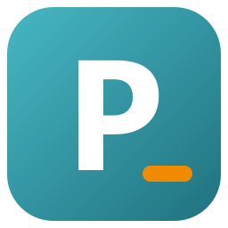
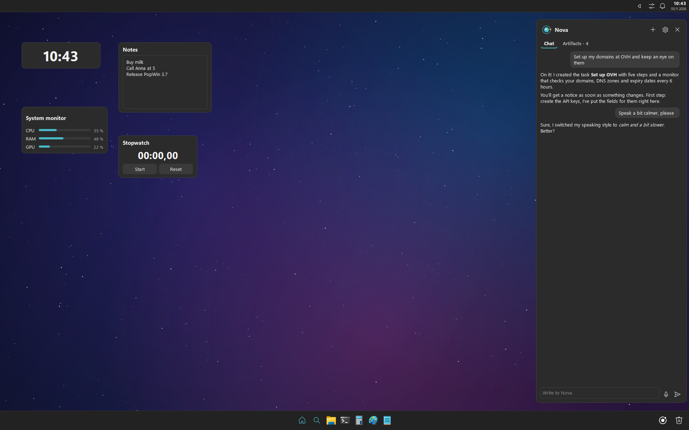
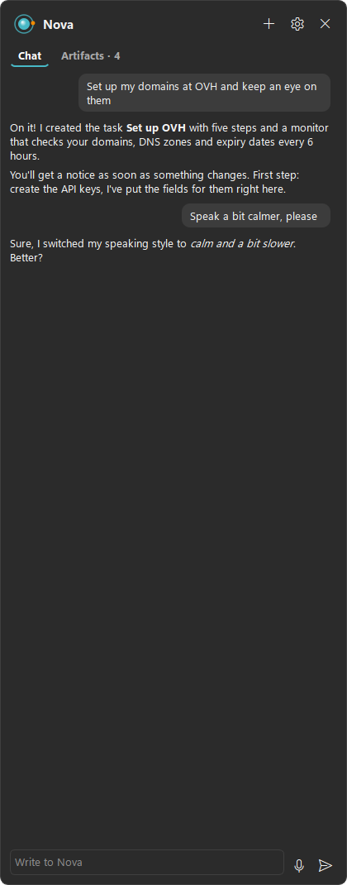
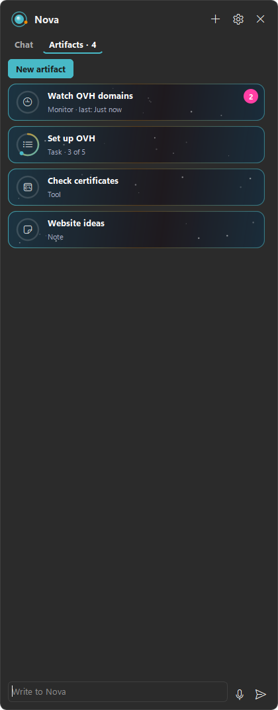
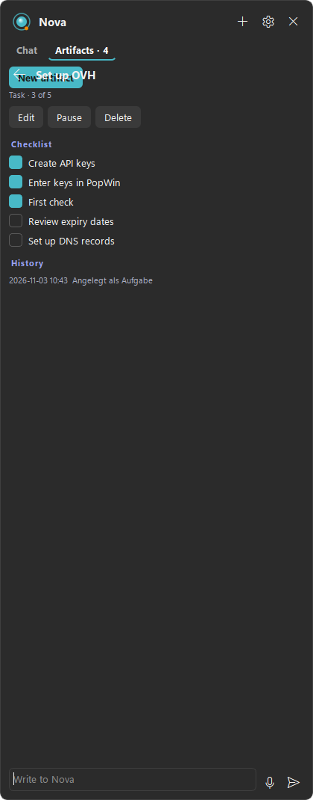
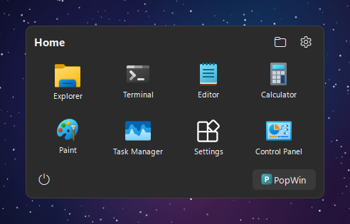
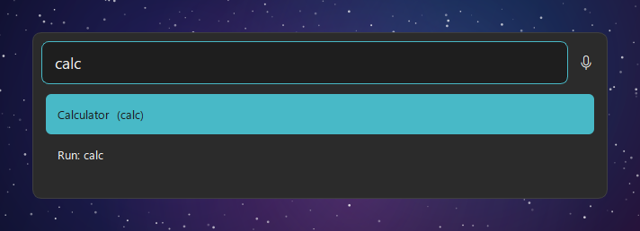
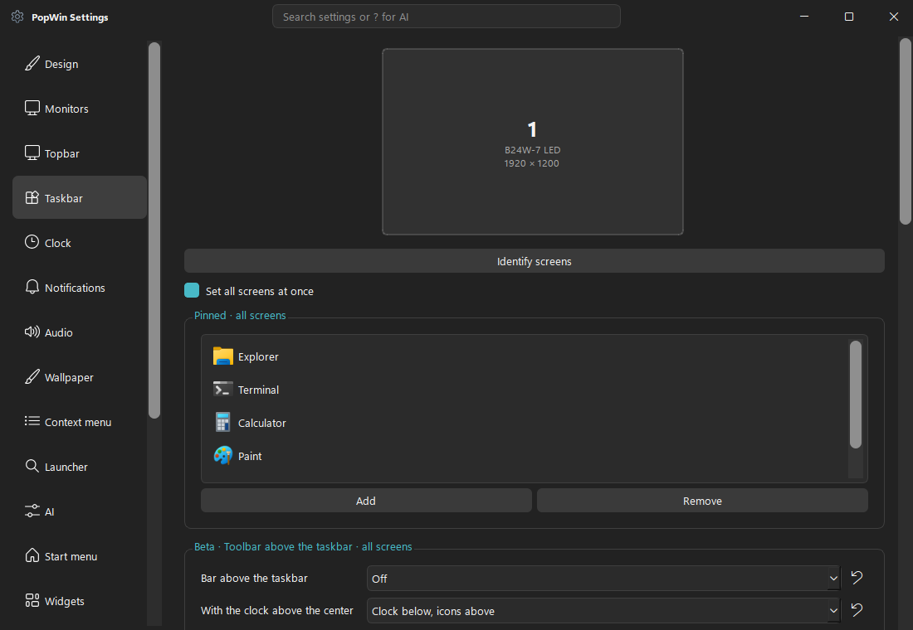
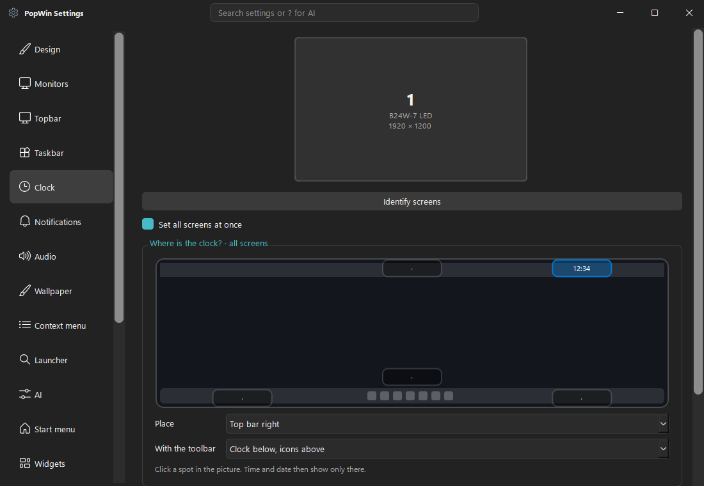

<p></p>

# PopWin

[](https://github.com/michig-code/PopWin/releases)


[](LICENSE)

A customizable desktop for Windows 10 and 11: a top bar and taskbar in the style of Pop!_OS, a fast search,
desktop widgets and **Nova**, an AI copilot that sits at the edge of the screen, talks with you live and keeps
track of longer tasks.
**[Deutsche Version](README.de.md)**

> 🤖 **PopWin was brought to life with the help of AI.** It is developed together with **Claude** (Anthropic), which
> wrote most of the code, tests and documentation – see [How PopWin is made](#how-popwin-is-made).

<p></p>
<p>
  
  
  
</p>
<p>
  
  
</p>
<p>
  
  
</p>

*Screenshots use example data.*

## Features
- **Top bar and taskbar** – on every monitor or only some, synced or set up per monitor; full width or just as wide as
  the icons, left, centered or right, auto-hide at the screen edge. The clock goes exactly where you click in a
  little picture of your screen.
- **Taskbar like Windows** – the same icons as the Windows taskbar (Store apps, Java games, web apps), fixed order,
  drag to rearrange, live preview on hover, pin anything by dragging it onto the bar
- **Toolbar above the taskbar (beta)** – Home, search, Nova and the trash float in their own bar, always or only on hover
- **Search** – apps, system actions and Win+R commands as you type, voice input, and `?` for a question to the AI.
  If nothing fits, the AI suggests actions that run only after your yes.
- **Home menu** – your pinned apps, opens with the Windows key; just start typing to search
- **Nova** – an AI copilot in a side panel, see [below](#nova)
- **Widgets** – 13 desktop widgets (clock, system monitor, notes, stopwatch, network, disks, media, …), each with its
  own size, colour, layer and opacity. They stay on the desktop when you press Win+D.
- **Quick settings** – dark mode, do not disturb, Bluetooth, focus timer, audio output, per-app volume with live levels
- **Wallpapers** – works with Wallpaper Engine, or plays its own animated backgrounds behind the desktop icons
- **PopWin apps** – a tabbed file explorer with preview, an editor, a terminal and PowerShell Studio with a debugger;
  as a beta, each one can replace its Windows counterpart (off by default, Settings → Beta)
- **Full screen aware** – games and videos get the screen to themselves; the bars come back when you leave
- **Safe** – the real Windows taskbar comes back when PopWin ends, even after a crash
- **Polish** – themes as plain QSS files, light and dark, smooth animations, English, German, Spanish and French

## Nova
Nova lives at the edge of the screen and stays open while you work.

- **Live conversation** – with voice turned on, Nova runs on Gemini Live: the microphone listens only while you speak,
  stops by itself when you pause and shows what it understood as you talk. Nova answers with her voice and the chat
  shows it as text. Without voice, Nova uses the regular models and the microphone dictates.
- **Her voice** – 30 voices and a speaking style in your own words, e.g. “calm and a bit slower”. Or just tell Nova
  how she should sound.
- **Artifacts** – for longer jobs Nova keeps an artifact: a task with a checklist and due date, a note, a monitor that
  checks something on a schedule, or a small tool (a Python script). You see them in their own tab with progress,
  history and code, can create and edit them yourself, and get a notice when a monitor finds something new.
- **Connections** – Nova can connect to services such as your OVH account. You type the keys into PopWin itself,
  never into the chat; they stay in the Windows Credential Manager and Nova never sees them.
- **On your PC** – Nova can look at the screen, open programs, read files and, if you allow it, use mouse and keyboard.
  Anything risky asks first and shows the real command, never just Nova's summary. Tools that change things ask
  every time, and the approval always shows their code.

Nova needs a free [Gemini API key](https://aistudio.google.com/apikey). It is stored in the Windows Credential Manager,
not in a settings file.

## Quick start
1. Download **`PopWin Setup.exe`** from the [releases](https://github.com/michig-code/PopWin/releases) and run it,
   or take **`PopWin Portable.zip`** for a USB stick.
2. On the first start the settings open on the **Setup** page: autostart, hiding the Windows taskbar and the optional
   Gemini key. Every step can be undone at any time. Later starts open no windows.
3. Press the Windows key for the Home menu, **Alt + Space** for the search, **Ctrl + Alt + N** for Nova.

**Quit:** Settings → Setup → *Disable PopWin*, or the emergency shortcut **Ctrl + Alt + Shift + K**. PopWin brings the
Windows taskbar back by itself, even after a crash; if it is ever missing, the Start menu entry
*Windows-Taskleiste wiederherstellen* restores it.

## Using PopWin
| What | How |
|---|---|
| Windows key | Opens the Home menu; start typing to search. Combinations like Win+D keep working |
| Search | **Alt + Space** or the magnifier. `? question` asks the AI, `cmd` or `shell:startup` work like Win+R |
| Dark mode | Type `dark mode` in the search, or use the quick settings |
| Volume | Scroll on the speaker icon, click it for the slider and the output device |
| Pin an app | Drag a file, program or shortcut onto the taskbar, or right-click a running app |
| Widgets | Right-click a widget for the gallery: add widgets and adjust each one |
| Settings search | Type in the settings title bar, or `?` to change settings in plain words |
| Monitors | Settings → Monitors: which bars on which screen, same look everywhere or per screen |
| Languages | Settings → Design → Language, or automatic like Windows |

## Privacy
PopWin itself sends nothing anywhere. Only what you ask the AI (search, voice input, Nova) goes to Google's Gemini API,
with your own key. Nova's memory, chat and artifacts stay on this PC; Settings → Privacy shows everything in one place
and can turn Nova's memory off or delete it. To detect an internet connection PopWin opens a connection to
`1.1.1.1:443` every 30 seconds without sending data.

## What works differently on purpose
- **Hidden tray icons:** Windows does not let other programs host them, so the arrow opens the real Windows overflow.
- **Right-click on files:** PopWin's menu is for the free desktop and its bars. On files the Windows menu stays,
  because only Windows knows the entries of installed programs.
- **Full screen:** a window covering a whole monitor sends the bars behind it on that monitor only.

## Development
For working on PopWin itself; to use it, take the Setup or the Portable version above.
```bash
python -m venv .venv && .venv\Scripts\pip install -r requirements.txt
.venv\Scripts\python main.py                                                       # run
.venv\Scripts\python tools/quiet_tests.py tests.log -m unittest tests.test_logic   # all tests
.venv\Scripts\python build.py                                                      # Setup.exe + Portable.zip in release/
```
The tests run on a separate, invisible Windows desktop, so windows, focus and mouse clicks never touch your screen.
They never use real accounts, the network or the Windows Credential Manager. `tools/readme_shots.py` renders the
screenshots above with example data.

```text
main.py            Start, wiring, safe exit
core/              Windows calls, system status, Nova's brain, tools, artifacts and live voice
ui/                Top bar, taskbar, search, menus, settings, Nova panel, widgets
explorer/ editor/ terminal/ studio/   PopWin apps
themes/            Plain QSS files, dark and light
assets/lang/       Translations; a new language is one JSON file
tests/             Logic and UI tests
```

## How PopWin is made
PopWin was brought to life with the help of AI. It is developed with **Claude**, an AI by Anthropic, using Claude Code:
most of the code, tests and documentation were written by Claude. [@michig-code](https://github.com/michig-code) had
the idea, decides what gets built, uses PopWin every day, tests every version on real PCs, reports bugs and maintains
the project.

Every change goes through the same checks: several hundred logic and UI tests on an invisible desktop, and a scan
that stops a release if it would contain a key. Found a bug? Please [open an issue](https://github.com/michig-code/PopWin/issues).

PopWin is not affiliated with Microsoft, System76 or Google.

## License
[GPL-3.0](LICENSE), because PopWin uses [python-chess](https://github.com/niklasf/python-chess). Third-party
libraries keep their own licences.
